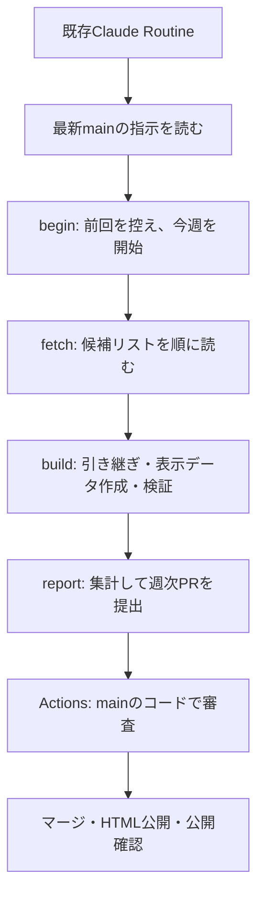

# 東京アフタヌーンティー

候補リストの公開ページを毎週読み、確認できたアフタヌーンティーをGitHub Pagesに掲載します。調査が途中でも集めた結果で掲載処理へ進み、保存した表示データから固定HTMLを生成します。

[公開サイト](https://tsubasa0518.github.io/afternoon-tea/) · [安全規則](AGENTS.md) · [週次手順と数値](docs/weekly_procedure.md)

