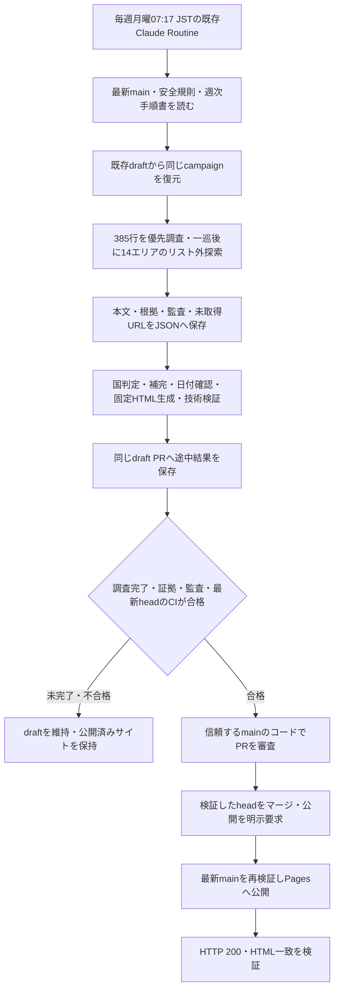

# 東京アフタヌーンティーの週次更新

東京の既存14エリアについて、ホテル・ラウンジ・カフェ等の公開AT情報を調べ、固定デザインのサイトを生成します。調査は既存のClaude Code Routine、検証・取り込み・公開はGitHub Actionsが担当します。予約や問い合わせは行いません。

- 公開サイト: https://tsubasa0518.github.io/afternoon-tea/
- 定期調査: 毎週月曜日07:17、Asia/Tokyo、クラウド環境afternoon-tea-weekly
- 実行環境: Python 3.12・標準ライブラリのみ。追加パッケージは不要です。
- 安全規則: [AGENTS.md](AGENTS.md)。Claudeの実行指示: [CLAUDE.md](CLAUDE.md)。具体的な週次手順は[docs/weekly_procedure.md](docs/weekly_procedure.md)の1つにまとめています。

## 調査対象と掲載

原本data/references/user_candidates_385.csvの385行をNo順に優先調査し、一巡後にリスト外を探索します。385は候補行数で、確認店舗数ではありません。同一店舗は店舗IDや取得した同一性の根拠でまとめ、同じホテルの別ラウンジは分けます。マスターは所在地や既存情報の参考であり、調査対象店舗数の上限ではありません。

対象はdata/store_master.jsonにある既存14エリアと対象駅です。15番「その他のエリア」はプラン調査・リスト外探索から外します。原本の行は残し、店舗所在地の根拠から範囲外と確認できた場合だけ理由付きで除外します。所在地不明を推測除外しません。現在のHTMLにある15番の表示枠は維持します。

店舗・プランの通常価格、期間、曜日・時間、メニュー、最寄駅、出典と実際の確認日時を保存します。不明はnullとし、取得失敗を提供なしと扱いません。最寄駅は駅名だけ、複数は「／」区切りです。出口・改札・徒歩分数・直結・道順は追加調査や専用項目への抽出を行いません。

通常価格は対象期間に重なるプランの最安通常価格から、cafe（6,000円以下）、hotel（6,001〜9,999円）、lux（10,000円以上）へ分類します。通常価格不明の場合のみ、確認できた施設情報を使い、施設も不明ならunknownです。割引から逆算しません。スイーツ15項目・季節、曜日、価格分類と料金帯の絞り込み、複数プラン、未確認表示、スマートフォン対応を維持します。出典・確認日時・内部判断根拠はJSONに保持し、画面には既存テンプレートが定める内容だけを表示します。

**調査未完了なら公開しません。** 正常な途中HTMLを生成・確認して同じdraftへ保存できますが、公開には385行の根拠、14エリア全対象駅の探索根拠、正常な監査と技術検証が必要です。店舗数だけでは判定しません。既存の情報やchecked_atを整形だけで最新確認済みにしません。

## 全体の流れ



## 構成と主要ファイル

```text
afternoon-tea/
├── .github/workflows/       テスト・週次PR取り込み・Pages公開の3本
├── afternoon_tea/
│   ├── __main__.py          単一CLI入口
│   ├── common.py            共有パス・JSON・ハッシュ
│   ├── collection/          店舗マスター・385行台帳・匿名GET・監査・証拠・復元
│   ├── processing/          日付・価格分類・タグ・テーマ国・補完
│   ├── publication/         公開条件・JSON/HTML検証・生成・PR審査・公開確認
│   └── templates/           固定HTML/CSS/JavaScript
├── data/                    保護されたマスター・国コード・公式入口
│   └── references/          385行の原本
├── site/                    research.json / search_failures.json / index.html
├── tests/                   モック・ローカルfixturesによる検証
├── docs/weekly_procedure.md  唯一の週次手順書
└── README.md / AGENTS.md / CLAUDE.md / .gitignore
```

| 場所 | 役割 |
| --- | --- |
| collection/campaign.py | 385行、店舗IDの照合、同じ調査のqueue・進捗復元 |
| collection/documents.py・transport.py | 匿名GET、robots、要求間隔、サイズ制限、リダイレクト禁止 |
| collection/audit.py・evidence.py | 通信監査のハッシュ鎖、取得本文・時刻・店舗の対応 |
| processing/ | 元の証拠・確認日時を変えずに保存情報を加工 |
| publication/gate.py | 原本、全行、14エリア全駅、鮮度・根拠・監査の完了判定 |
| publication/site.py・ci.py | PRの資格と最新head CI、取り込み、公開準備・確認 |
| publication/renderer.py・templates/ | 固定デザインで同じJSONから同じHTMLを生成 |
| data/protected_hashes.json | 現行設定・原本・マスター・指示書・テンプレートの保護 |

店舗マスターの正本はdata/store_master.jsonです。ロード時に固定SHA-256、14エリア、3分類、店舗ID連番と件数を検証します。本文・未取得queue・証拠・監査はsite/search_failures.jsonのresearch_campaignに保存し、未完了の調査は週をまたいで同じcampaign_idで再開します。証拠は開始日以降かつ直近14日以内であることを要求し、旧形式を無検証で昇格させません。

## ローカル実行とテスト

```sh
python3 -m afternoon_tea --help
python3 -m afternoon_tea check-protected
python3 -m afternoon_tea validate-catalog
python3 -m afternoon_tea review --period
python3 -m afternoon_tea review
python3 -m afternoon_tea validate-site
python3 -m unittest discover -s tests -v
```

調査結果を反映するときは週次手順書に従い、themes-prepare、判断、themes-finalize、enrich、review、render、validate-siteを実行します。`render`はsite/index.htmlを生成します。調査を開始する`collect`と`collect-official`、GitHubを書き換える`intake`や公開処理は、単なるローカル検証のためには実行しません。各サブコマンドの`--help`は通信もファイル書き換えもしません。

JavaScriptフィルターの実行テストは、既存のNode実行環境がPATHにあるときに追加で動きます。Python処理の依存パッケージではありません。Nodeがない場合のスキップは結果に明記してください。

## GitHub Actionsと公開保護

| ワークフロー | 動作 |
| --- | --- |
| test-data.yml | PR・mainのPython 3.12オフラインテストと保護ハッシュ検証 |
| auto-merge-weekly.yml | 週次PRとテスト完了イベントを受け、資格・データ・公開条件・最新headを審査 |
| deploy.yml | 承認済みmainのデータを再検証し、HTML公開後のHTTPとSHA-256一致を確認 |

テストワークフロー名は`Test offline data and HTML pipeline`です。完了イベントを参照する側もこの名前を使います。PR取り込みではPRコードをcheckout・実行せず、pull_request_targetの信頼するgithub.shaを使用し、persist-credentials:falseを維持します。許可作成者はCLAUDE_ROUTINE_AUTHOR、未設定ならリポジトリ所有者です。

週次PRの資格は同一リポジトリ、main宛て、許可作成者、claude/weekly-afternoon-tea-ブランチ、[weekly-site]タイトル、許可3ファイルのみです。fork・symlink・想定外の変更を拒否します。取り込みジョブの既存書き込み権限と、公開ジョブだけのPages権限を分離します。期待headを指定してマージし、公開要求の重複は要求記録と実行記録で防ぎます。

公開準備には、承認済みの既存JSONスナップショットに完全一致する表示保守だけの例外があります。週次PRの取り込みには適用せず、新しいデータや途中台帳には通常の完了判定を必須とします。この例外の範囲や固定ハッシュを、週次実行で変更してはいけません。

## エラー時の対応

- 禁止操作・リダイレクトを検知したら全体停止し、監査を残します。停止フラグだけを消さず、禁止先・転送先を再取得しません。
- 一時的な通信障害は未取得URLを残します。保存エラー・秘密情報検知とは区別し、後者は自動再試行しません。
- 未完了・証拠不足・期限切れ・監査失敗はdraftに保存し、公開済みサイトを維持します。HTML生成成功を調査完了と扱いません。
- CI・公開が失敗したら、実際のheadとログを確認し、ブランチ保護・権限・公開条件を自動解除しません。公開だけの復旧は承認済みコミットに対して行い、調査を重複起動しません。
- 復元元のdraftがmainより新しい台帳を持つ場合は、その同じPRから復元します。保存できた範囲と未実施範囲、ローカル・クラウド・定期実行・公開の確認段階を分けて報告します。

## 国コード資料の出所

country_registry.jsonはテーマ判定の固定ルールではなく、全ISO 3166-1 alpha-2割当を照合する軽量資料です。作成時に端末内IANA tzdbのiso3166.tab（2025-07-01注記、ISO/TC 46 N1127 2024-02-29参照、public domain）と、NodeのIntl.DisplayNamesにあるUnicode CLDR名を組み合わせました。ICU/CLDRの版はJSONに記録しています。週次処理は同梱JSONを読み、追加HTTPや国の手動事前登録は行いません。国旗のための追加調査・画像生成は禁止し、取得済みのプラン内容から判断した明記・推測・不明を区別します。
