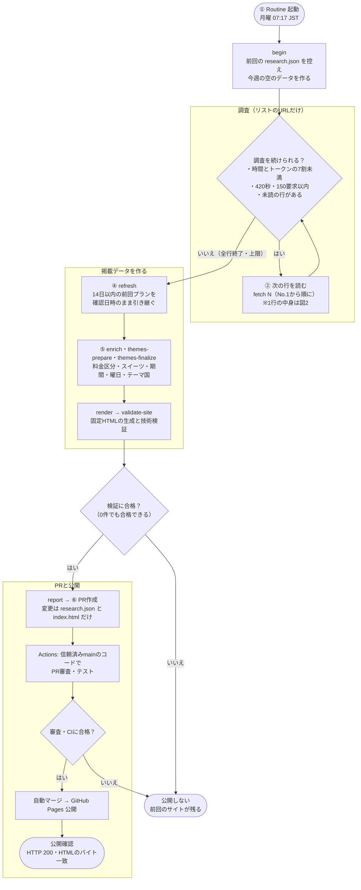

# 東京アフタヌーンティー

東京14エリアのホテル・カフェのアフタヌーンティー（AT）を毎週調べ、固定HTMLで掲載します。調べるのは候補リストに載っている店舗の予約ページURLだけです。毎週No.1から順に読み、時間切れでも読めた分で公開します。確認後14日以内の前回プランは、実際の確認日時のまま引き継ぎます。0件も正常な公開です。予約操作は行いません。

## 構成

```text
.github/workflows/     CI・信頼済みmainでのPR審査・Pages公開
afternoon_tea/
  __main__.py         python3 -m afternoon_tea の入口
  common.py           共通パス・JSON
  collection/         候補リスト、匿名GET、URL検査、任意のヘッドレスブラウザ、週次の上限と報告
  processing/         14日引継ぎ、料金区分・期間・曜日・スイーツ・テーマ国
  publication/        固定HTML生成、技術検証、PR審査、公開前後の確認、保護確認
  templates/          デザイン・検索・絞り込み
data/
  references/user_candidates.csv  候補リスト（14エリアだけ・エリア番号つき）
  store_master.json   14エリアと対象駅
  country_registry.json  テーマ国
  protected_hashes.json  保護ファイルのハッシュ
docs/weekly_procedure.md         毎回読む週次手順
requirements-browser.txt          任意のヘッドレスブラウザ（Playwright）
site/research.json     掲載する店舗・プラン
site/index.html        生成した公開HTML
tests/                外部接続なしのテスト・fixtures
```

## 流れ

既存のClaude Routine（月曜07:17 JST）だけが調査を起動します。

1. `begin` で前回データを控え、今週の空のデータを作る
2. リストNo.1から順に `fetch N` で予約ページURLを読み、必要なら同じ店舗のプラン詳細ページも読む。プランが読めた店舗だけ採用し、読めない店舗は諦めて次へ
3. 時間・トークンの7割（調査420秒・150要求まで、1店舗60秒まで）で調査をやめる
4. `refresh` で14日以内の前回プランを引き継ぎ、`enrich`・`themes-prepare`・`themes-finalize` で補完、`render` でHTML生成、`validate-site` で検証
5. `report` の集計を本文にしたPRを作る。Actionsが審査・テスト・自動マージ・Pages公開・公開確認を行う

GET本文にプランが見えないページ（JavaScriptで表示されるページ）だけ、同じURLをヘッドレスブラウザで開きます。押せるのは「もっと見る」「プラン」「閉じる」など同じページ内で表示を広げるボタンだけで、予約・日付・人数・フォーム・ログイン・ページ遷移・GET以外の通信はコードが送信前に止めます。ブラウザが使えない環境ではGETだけで続けます。詳細は [週次手順](docs/weekly_procedure.md)、安全規則は [AGENTS.md](AGENTS.md) を参照してください。

週次が変更できるのは `site/research.json` と `site/index.html` だけです。

## フロー図

GitHub上では、次の3つの図がそのまま図として表示されます。

### 図1 週次の全体の流れ

毎週の処理は、「調査」「掲載データ作り」「PRと公開」の3段階です。調査は途中で止まっても、そこまでの結果で次の段階へ進みます。止まるのは、検証や審査に落ちたとき（仕組みが壊れているとき）だけです。



### 図2 1行（1店舗）の読み方

1行で開くのは、その行の予約ページURLと、同じ店舗のプラン詳細ページだけです。どこかで引っかかったら、その店舗だけを諦めて次の行へ進みます。403・429・CAPTCHAが出たサイトは、その週の残りの行でも開きません。ATプランがない・情報が足りない店舗も「ない」として諦めます。


### 図3 ブラウザで許可すること・止めること

ブラウザの操作や通信は、すべて実行する前にコードが判定します。許可の条件に当てはまらないものは、送らずに止めます。


ブラウザは毎回、空の状態で開きます。Cookie・ログイン状態は保存せず、ダウンロードもしません。

## 公開条件

同一リポジトリ・許可作成者・main宛て・指定ブランチ/タイトル・2ファイル制限、検証したhead SHAのCI成功、JSON/HTMLの技術検証（フォーム・外部スクリプトなどがない、構造が正しい）、各プランのタイムゾーン付き確認日時（直近14日以内・未来でない）、14エリア、秘密情報・個人情報なしを確認します。調査の完了度や件数は条件にしません。Pages権限は公開ジョブに限定し、公開後にHTTP 200とHTMLの一致を検証します。

## コマンド

| コマンド | 役割 |
| --- | --- |
| `begin` | 週の開始（前回データの控え、空の調査ファイル、時間・要求数の初期化） |
| `fetch N [URL] [--browser]` | リストNo.Nの予約ページURL（または同じ店舗のプラン詳細ページ）を読む |
| `refresh` | 14日以内の前回プランを確認日時のまま引き継ぐ |
| `enrich` | 料金区分・スイーツ・期間・曜日 |
| `themes-prepare` / `themes-finalize` | テーマ国 |
| `render` | 固定HTML生成 |
| `validate-site` | JSON・HTMLの技術検証 |
| `report` | PR本文用の集計 |
| `check-protected` | 保護ファイルの確認 |
| `intake` / `resume-intake` | 週次PRの審査と自動マージ（Actions用） |
| `publish-prepare` / `publish-verify` | 公開前検証・公開後確認（Actions用） |

ローカル検証は `python3 -m unittest discover -s tests`。Python標準ライブラリだけで動きます（ブラウザのテストはモックで行います）。絞り込みの実行テストにはNode.jsも必要です（CIのUbuntuには付属）。

## うまくいかないとき

転送・危険な要求は送信せず、その店舗を諦めて次へ進みます。403・429・CAPTCHA・robots拒否は回避しません（403・429・CAPTCHAのサイトは同じ週に再試行しません）。サイズ超過・秘密情報のあるページは使いません。時間・通信上限に当たっても、読めた分で公開手順へ進みます。JSON破損、生成失敗、危険なHTML、秘密情報、PR審査不合格の場合だけは公開せず、前回のサイトを残します。保護や必須レビューは解除しません。
