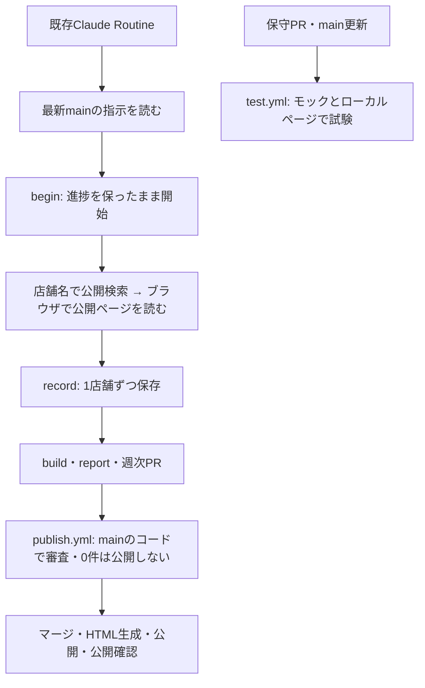

# 東京アフタヌーンティー

東京のアフタヌーンティーを、公開ページで確認できた内容だけGitHub Pagesに掲載します。所有者の候補リストを店舗名・ホテル名から検索して調べ、進捗を保存して次回は未調査分から続けます。調査JSONをGitに保存し、公開時に固定HTMLを生成します。掲載対象が0件の結果は公開しません。

**公開ページ：[https://tsubasa0518.github.io/afternoon-tea/](https://tsubasa0518.github.io/afternoon-tea/)**

[調査担当への指示](AGENTS.md) · [操作手順](docs/weekly_procedure.md)

## ディレクトリ構成と各ファイルの役割

```text
afternoon-tea/
├── .github/
│   └── workflows/
│       ├── publish.yml                 # 週次PRの審査・マージ、HTML生成、Pages公開と公開後の確認
│       └── test.yml                    # 通常PRとmain更新時のオフライン・ローカルブラウザテスト
├── afternoon_tea/                      # 調査・データ整形・ページ生成・公開検証のPythonコード
│   ├── __init__.py                     # Pythonパッケージとして読み込むための入口
│   ├── __main__.py                     # python3 -m afternoon_tea のコマンド受付・各処理への振り分け
│   ├── browser.py                      # 調査用ブラウザ、検索フォーム・タブ操作と予約操作の防止
│   ├── build.py                        # 保存データの整形、料金分類・季節表示値の作成、掲載対象の選別
│   ├── check.py                        # JSON・HTMLの安全検査、0件公開の防止、PR審査と公開後の照合
│   ├── config.py                       # 設定・候補リストの読込み、店舗照合、除外ジャンルと検索語の処理
│   ├── fetch.py                        # 公開ページの読取り、URL・robots・アクセス拒否・要求間隔の判定
│   ├── render.py                       # 保存JSONから店舗カード・プラン・エリアを含む固定HTMLを生成
│   ├── research.py                     # 調査順序・再開位置・確認結果の保存、進捗と報告の集計
│   └── templates/
│       ├── site.html                   # 公開ページ全体のHTMLの枠組み
│       ├── site.css                    # 色・文字・カード・スマートフォン表示などのデザイン
│       └── site.js                     # 分類・日程・料金帯の絞り込みと表示件数の更新
├── data/                              # 調査・掲載に使う設定と参照データ
│   ├── areas.json                      # 東京14エリアの番号・名称・対象駅
│   ├── candidates.csv                  # 調べたい店舗・ホテル、エリア、ジャンル、優先サイト等の一覧
│   ├── country_registry.json           # テーマ国の国コードと国旗表示に使う参照データ
│   ├── excluded_genres.json            # 調査・掲載から除外する主ジャンル（所有者が編集する設定）
│   ├── research_settings.json          # 調査の上限・取得間隔・再試行・再確認などの設定
│   └── references/
│       └── user_candidates.csv         # 所有者から受け取った元の候補リストの保管用原本
├── docs/
│   └── weekly_procedure.md             # 調査開始から1店舗ごとの保存、週次PR・公開までの操作手順
├── site/
│   └── research.json                   # 掲載店舗・プラン・出典・確認日時と、次回へ引き継ぐ調査進捗
├── tests/                             # 外部の店舗サイトを操作せずに動作を確かめるテスト
│   ├── __init__.py                     # テストをPythonパッケージとして読み込むためのファイル
│   ├── html_nodes.py                   # 生成HTMLの要素を読み取るテスト用補助処理
│   ├── http_fixtures.py                # 実際の通信の代わりに使うHTTP応答データ
│   ├── local_site.py                   # 検索・プラン表示・予約禁止を試験するローカルの模擬サイト
│   ├── test_browser.py                 # ブラウザの検索・移動・タブ操作と予約操作の拒否を検証
│   ├── test_build.py                   # データ整形・料金分類・季節表示・情報保持・文書の整合性を検証
│   ├── test_check.py                   # 公開前後の検査、PR審査、権限の境界、0件公開の防止を検証
│   ├── test_render.py                  # HTML・店舗カード・表示項目・レイアウト・絞り込みを検証
│   ├── test_safety.py                  # 通信制限・アクセス拒否・ジャンル除外・店舗照合・調査再開を検証
│   └── fixtures/
│       └── filter_harness.js     # 生成ページの実際のJavaScriptで絞り込み結果を検証する補助処理
├── .gitignore                         # 生成HTML・一時作業ファイル・PythonキャッシュをGitの追跡から除外
├── AGENTS.md                          # 調査担当と既存Claude Routineが守る7項目の指示の正本
├── CLAUDE.md                          # Claudeが毎回読む指示書と操作手順への案内
├── README.md                          # 公開URL、リポジトリの構成・ファイルの役割・処理の流れの案内
└── requirements-browser.txt           # 調査用ブラウザとローカルブラウザテストに必要なPython依存関係
```

`site/index.html` は保存JSONから生成するローカル確認用ファイルで、Gitには登録しません。公開用HTMLは `publish.yml` がmainのデータとコードから生成します。`.staging/` はブラウザ・取得処理の一時状態や公開用生成物を置く作業用ディレクトリで、こちらもGitには登録しません。

候補店舗を編集する場合は [data/candidates.csv](data/candidates.csv)、除外ジャンルは [data/excluded_genres.json](data/excluded_genres.json)、調査の設定は [data/research_settings.json](data/research_settings.json) を参照してください。元のリストは [data/references/user_candidates.csv](data/references/user_candidates.csv) に保管しています。調査方法と操作例は [docs/weekly_procedure.md](docs/weekly_procedure.md) にまとめています。

## 調査から公開までの流れ


