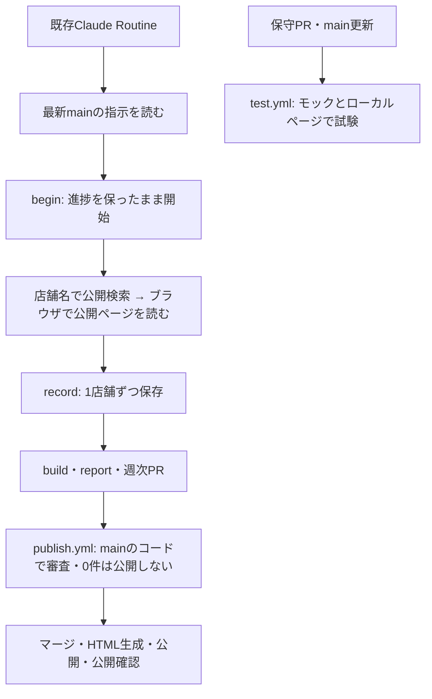

# 東京アフタヌーンティー

デートの予定づくりに使える東京のアフタヌーンティーを、公開ページで確認できた内容だけGitHub Pagesに掲載します。所有者の候補リストを店舗名・ホテル名から検索して調べ、進捗を保存して次回は未調査分から続けます。調査JSONをGitに保存し、公開時に固定HTMLを生成します。掲載対象が0件の結果は公開しません。

[公開サイト](https://tsubasa0518.github.io/afternoon-tea/) · [調査担当への指示](AGENTS.md) · [操作手順](docs/weekly_procedure.md)

| ファイル | 内容 |
|---|---|
| `data/candidates.csv` | 調べてほしい店舗・ホテルの一覧（参考URLは任意） |
| `data/references/user_candidates.csv` | 所有者から受け取った元のリスト（変更しない） |
| `data/excluded_genres.json` | 掲載しない主ジャンル（所有者が編集できる） |
| `data/research_settings.json` | 調査の上限・間隔・再確認の日数 |
| `site/research.json` | 掲載データと調査進捗 |

