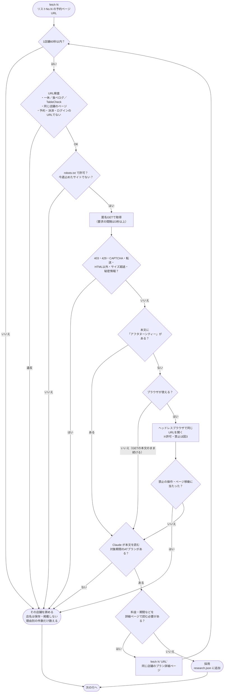
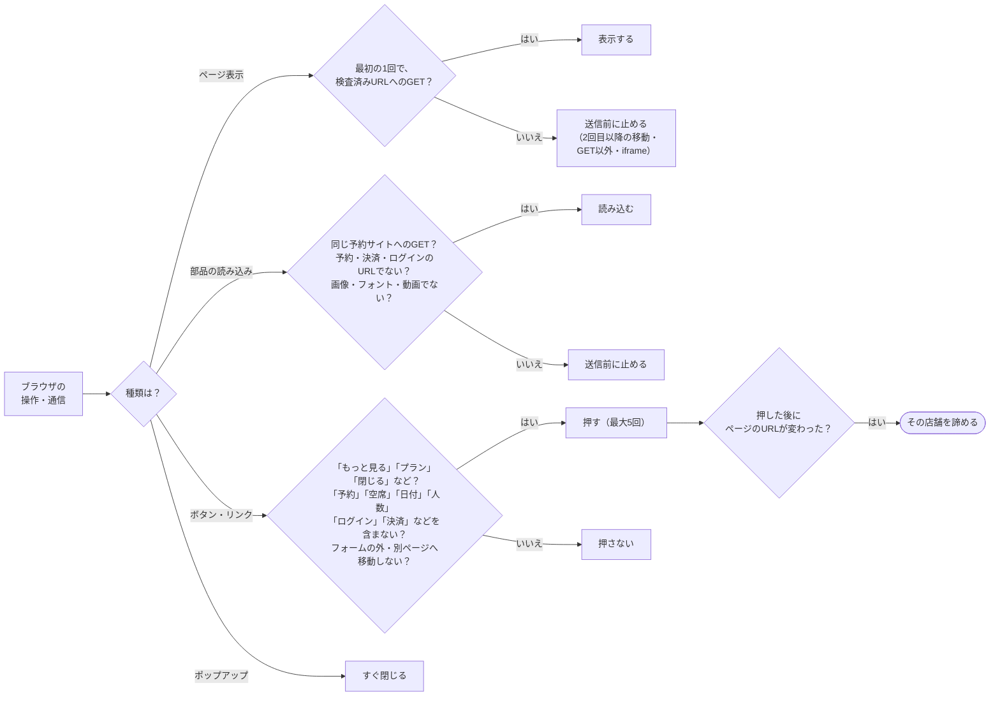
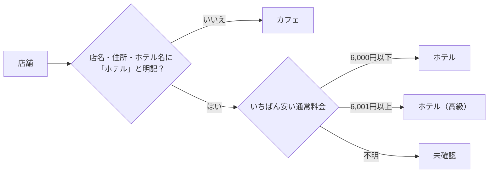

# 東京アフタヌーンティー

**公開サイト: https://tsubasa0518.github.io/afternoon-tea/**

東京14エリアのホテル・カフェのアフタヌーンティー（AT）を毎週調べ、固定HTMLで掲載します。調べるのは候補リストに載っている店舗の予約ページURLだけです。毎週No.1から順に読み、時間切れでも読めた分で公開します。確認後14日以内の前回プランは、実際の確認日時のまま引き継ぎます。0件も正常な公開です。予約操作は行いません。

## ファイルとフォルダの構成

大きく分けると、次の4つです。

| 場所 | 役割 |
| --- | --- |
| `afternoon_tea/` | 処理のプログラム本体（調査 → 加工 → 公開） |
| `data/` | 候補リストや14エリアなど、毎週は変えない基礎データ |
| `site/` | 公開するデータとHTML（週次で変わるのはこの2ファイルだけ） |
| `tests/` | 外部につながずに動作を確かめるテスト |

ファイルごとの役割は次のとおりです。

```text
afternoon-tea/
├── README.md                  この説明書
├── AGENTS.md                  安全規則（予約禁止・匿名GET・ブラウザの許可と禁止など）
├── CLAUDE.md                  Claude Routine が毎回最初に読む要点
├── requirements-browser.txt   任意のヘッドレスブラウザ（Playwright）の版指定
├── .gitignore                 Gitに入れないもの（作業用の .staging/ など）
│
├── .github/workflows/         GitHub Actions（自動処理）
│   ├── test-data.yml          PRとmainでテストを実行する
│   ├── auto-merge-weekly.yml  週次PRを審査し、合格なら自動マージする
│   └── deploy.yml             mainの site/ を GitHub Pages に公開し、公開後に確認する
│
├── docs/
│   └── weekly_procedure.md    毎週の作業手順書
│
├── afternoon_tea/             プログラム本体（python3 -m afternoon_tea で動かす）
│   ├── __main__.py            入口。サブコマンド（begin・fetch・render など）を受け付ける
│   ├── common.py              共通の部品（場所の指定・JSONの読み書き・検証）
│   │
│   ├── collection/            ① 調査：ページを安全に読む
│   │   ├── weekly.py          候補リストの読み込み、fetch N（No.1から順に）、時間・要求数の上限、PR本文用の集計
│   │   ├── transport.py       URL検査（許可サイト・同じ店舗・予約/決済URLの禁止）と、GETだけの通信
│   │   ├── reader.py          robots.txt の確認、要求間隔、403・429・CAPTCHA時の停止
│   │   ├── browser.py         任意のヘッドレスブラウザ（押してよいボタンと、止める操作・通信の判定）
│   │   ├── catalog.py         14エリアの基礎データ（store_master.json）の読み込みと検査
│   │   └── storage.py         ファイルの安全な書き込みと、同時実行の防止
│   │
│   ├── processing/            ② 加工：表示用の情報を付ける
│   │   ├── weekly.py          14日以内の前回プランの引き継ぎと、確認日時の検査
│   │   ├── enrichment.py      期間・曜日・季節などの表示用の項目（料金区分・スイーツもここから付ける）
│   │   ├── classification.py  分類（ホテルと明記されているか＋料金で、カフェ／ホテル／ホテル（高級））
│   │   ├── sweets.py          スイーツの種類のタグ（いちご・栗など）
│   │   ├── themes.py          テーマ国（国旗）の判定の準備と確定
│   │   ├── dates.py           日本時間の日付と、40日間の対象期間
│   │   └── period_review.py   対象期間外のプランを見分ける
│   │
│   ├── publication/           ③ 公開：HTMLを作り、確かめる
│   │   ├── renderer.py        site/research.json から site/index.html を作る
│   │   ├── site.py            HTML・JSONの技術検証、週次PRの審査、公開前後の確認
│   │   ├── ci.py              テスト完了後に週次PRの審査を再開する
│   │   └── guards.py          保護ファイルが変えられていないかの確認
│   │
│   └── templates/             ページのデザイン（毎週は変えない）
│       ├── site.html          ページの骨組み
│       ├── site.css           見た目
│       ├── site_extra.css     見た目の追加分（未確認の値など）
│       ├── site.js            絞り込み（カテゴリ・曜日・スイーツ）
│       └── site_extra.js      絞り込みの追加分（料金帯・エリアの開閉など）
│
├── data/                      基礎データ
│   ├── references/
│   │   └── user_candidates.csv  候補リスト（331行・14エリアだけ・エリア番号つき）
│   ├── store_master.json      14エリアの名前と対象駅
│   ├── country_registry.json  テーマ国の一覧（国コードと国名）
│   └── protected_hashes.json  保護ファイルのハッシュ（勝手な変更の検出用）
│
├── site/                      公開するもの（週次で変わるのはここだけ）
│   ├── research.json          掲載する店舗・プランのデータ
│   └── index.html             公開サイトのHTML（research.json から生成）
│
└── tests/                     テスト（外部サイトにはつながない）
    ├── test_simple_weekly.py  週次の流れ・ブラウザの安全規則・14日引継ぎ・報告
    ├── test_read_only.py      URL検査・GETだけの通信・robots・拒否時の停止
    ├── test_site_intake.py    週次PRの審査とHTML・JSONの技術検証
    ├── test_renderer.py       HTML生成とデザイン
    ├── test_*.py              そのほか（料金区分・スイーツ・テーマ国・期間・構成など）
    ├── html_nodes.py          テスト用：生成したHTMLを調べる道具
    ├── http_fixtures.py       テスト用：通信の代わりに返す偽の応答
    └── fixtures/              テスト用の保存済みページの抜粋など
```

## 流れ

既存のClaude Routine（月曜07:17 JST）だけが調査を起動します。

1. `begin` で前回データを控え、今週の空のデータを作る
2. リストNo.1から順に `fetch N` で予約ページURLを読み、必要なら同じ店舗のプラン詳細ページも読む。プランが読めた店舗だけ採用し、読めない店舗は諦めて次へ
3. 時間・トークンの7割（調査420秒・150要求まで、1店舗60秒まで）で調査をやめる
4. `refresh` で14日以内の前回プランを引き継ぎ、`enrich`・`themes-prepare`・`themes-finalize` で補完、`render` でHTML生成、`validate-site` で検証
5. `report` の集計を本文にしたPRを作る。Actionsが審査・テスト・自動マージ・Pages公開・公開確認を行う

GET本文にプランが見えないページ（JavaScriptで表示されるページ）だけ、同じURLをヘッドレスブラウザで開きます。押せるのは「もっと見る」「プラン」「閉じる」など同じページ内で表示を広げるボタンだけで、予約・日付・人数・フォーム・ログイン・ページ遷移・GET以外の通信はコードが送信前に止めます。ブラウザが使えない環境ではGETだけで続けます。詳細は [週次手順](docs/weekly_procedure.md)、安全規則は [AGENTS.md](AGENTS.md) を参照してください。

週次が変更できるのは `site/research.json` と `site/index.html` だけです。

## フロー図

GitHub上では、次の3つの図がそのまま図として表示されます。

### 図1 週次の全体の流れ

毎週の処理は、「調査」「掲載データ作り」「PRと公開」の3段階です。調査は途中で止まっても、そこまでの結果で次の段階へ進みます。止まるのは、検証や審査に落ちたとき（仕組みが壊れているとき）だけです。


### 図2 1行（1店舗）の読み方

1行で開くのは、その行の予約ページURLと、同じ店舗のプラン詳細ページだけです。どこかで引っかかったら、その店舗だけを諦めて次の行へ進みます。403・429・CAPTCHAが出たサイトは、その週の残りの行でも開きません。ATプランがない・情報が足りない店舗も「ない」として諦めます。



### 図3 ブラウザで許可すること・止めること

ブラウザの操作や通信は、すべて実行する前にコードが判定します。許可の条件に当てはまらないものは、送らずに止めます。



ブラウザは毎回、空の状態で開きます。Cookie・ログイン状態は保存せず、ダウンロードもしません。

## 分類（カフェ・ホテル・ホテル（高級））

各店舗は次の順に判定します（`afternoon_tea/processing/classification.py`）。

1. **ホテルと明記されているか**: 次のどれかに「ホテル」（英語の HOTEL を含む）の文字があれば、ホテル側に入れます。
   - 店名（`name`）
   - 住所（`address`）
   - 調査時に記録したホテル名（`hotel_name`）。予約ページにホテルであることが明記されている場合だけ記録します
2. **明記されていなければ**: 料金に関係なく **カフェ**
3. **ホテル側の店舗は料金で分ける**: 対象期間のプランの通常料金のうち、いちばん安いものが
   - **6,000円以下 → ホテル**
   - **6,001円以上 → ホテル（高級）**
   - 料金が分からない → **未確認**



絞り込みの「料金帯」（6,000円以下／6,001〜9,999円／10,000円以上）は、この分類とは別の、料金だけで絞り込む機能です。

## 公開条件

同一リポジトリ・許可作成者・main宛て・指定ブランチ/タイトル・2ファイル制限、検証したhead SHAのCI成功、JSON/HTMLの技術検証（フォーム・外部スクリプトなどがない、構造が正しい）、各プランのタイムゾーン付き確認日時（直近14日以内・未来でない）、14エリア、秘密情報・個人情報なしを確認します。調査の完了度や件数は条件にしません。Pages権限は公開ジョブに限定し、公開後にHTTP 200とHTMLの一致を検証します。

## コマンド

| コマンド | 役割 |
| --- | --- |
| `begin` | 週の開始（前回データの控え、空の調査ファイル、時間・要求数の初期化） |
| `fetch N [URL] [--browser]` | リストNo.Nの予約ページURL（または同じ店舗のプラン詳細ページ）を読む |
| `refresh` | 14日以内の前回プランを確認日時のまま引き継ぐ |
| `enrich` | 料金区分・スイーツ・期間・曜日 |
| `themes-prepare` / `themes-finalize` | テーマ国 |
| `render` | 固定HTML生成 |
| `validate-site` | JSON・HTMLの技術検証 |
| `report` | PR本文用の集計 |
| `check-protected` | 保護ファイルの確認 |
| `intake` / `resume-intake` | 週次PRの審査と自動マージ（Actions用） |
| `publish-prepare` / `publish-verify` | 公開前検証・公開後確認（Actions用） |

ローカル検証は `python3 -m unittest discover -s tests`。Python標準ライブラリだけで動きます（ブラウザのテストはモックで行います）。絞り込みの実行テストにはNode.jsも必要です（CIのUbuntuには付属）。

## うまくいかないとき

転送・危険な要求は送信せず、その店舗を諦めて次へ進みます。403・429・CAPTCHA・robots拒否は回避しません（403・429・CAPTCHAのサイトは同じ週に再試行しません）。サイズ超過・秘密情報のあるページは使いません。時間・通信上限に当たっても、読めた分で公開手順へ進みます。JSON破損、生成失敗、危険なHTML、秘密情報、PR審査不合格の場合だけは公開せず、前回のサイトを残します。保護や必須レビューは解除しません。
