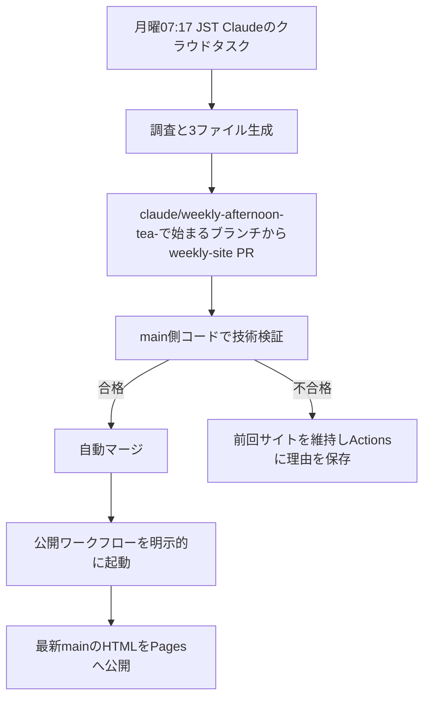

# 毎週の自動更新

Claude Codeが調査とHTML作成、GitHubが検証・取り込み・公開を担当します。Codexの定期実行やOpenAI APIは使用しません。



## 最初の一度だけ行う設定

1. [Claude Codeクラウドタスク](https://claude.ai/code/routines)でGitHubを接続し、`tsubasa0518/afternoon-tea`への取得・ブランチpush・PR作成を許可します。ClaudeのGitHub操作は接続ユーザーの名義です。本人の接続・権限承認は代行できません。追加のAPIキーやPATは不要です。
2. タスクを作成し、このリポジトリ、main、下記プロンプトを指定します。毎週月曜日07:17、タイムゾーンAsia/Tokyoを選びます。UTC指定の5フィールドcronなら `17 22 * * 0` です。不要なコネクターを外してください。
3. GitHubのRepository variables `CLAUDE_ROUTINE_AUTHOR`を実際のPR作成者loginに設定します。未設定ならリポジトリ所有者`tsubasa0518`のみ許可します。bot名を推測して設定しないでください。
4. GitHub Settings → Pages → SourceをGitHub Actionsにします。既存のgithub-pages Environmentに毎回の承認必須設定があると無人公開が止まります。その場合は本人が保護方針を確認してください。
5. Claudeで一度Run nowを実行し、PR作成とActionsログを確認します。成功表示だけでPR作成済みとは判断しません。

Claude公式の現在の名称はCloud Scheduled Tasks（旧Routines）です。毎回クラウドでリポジトリを取得し、通常claude/weekly-afternoon-tea-で始まるブランチを作成します。公式仕様: https://code.claude.com/docs/en/routines 。通常の契約枠を利用し、有料APIや追加の従量課金は設定しません。環境のネットワーク許可が不足する場合は、必要な公開ドメインだけを本人が許可します。サイト側のrobots・403・CAPTCHAは回避しません。

## 3ファイル

- `site/index.html`: インラインCSS・フィルター用JavaScriptを持つ単独HTML。Pagesで公開するのはこのファイルだけです。画像は埋め込み、フォントは任意のGoogle Fontsのみを使用します。外部JavaScript・フォーム・自動通信を含めません。
- `site/research.json`: `schema_version: 1`, `generated_at`（タイムゾーン付きISO日時）, `shops`配列。各店舗に名前・エリア・確認した情報・原文・出典URL・確認日時を保存します。不明値はnullです。
- `site/search_failures.json`: 同様にschema_version・generated_at・`failures`配列。各記録はname, area, checked_at, sources（URL配列）, status, reason, retry（真偽値）を持ちます。statusは`information_insufficient`, `access_denied`, `site_restriction`, `no_results`, `unresearched`, `confirmed`です。必要ならstation（駅）とscope（shop/site/area/station）も記録します。情報取得失敗はAT提供なしの証明ではありません。

例（書式説明用。本番調査結果ではありません）:

```json
{"schema_version":1,"generated_at":"2026-11-09T07:17:00+09:00","failures":[{"name":"書式説明用","area":"対象エリア","checked_at":"2026-11-09T07:17:00+09:00","sources":[],"status":"unresearched","reason":"時間制限に達した","retry":true}]}
```

初期のindex.htmlは旧120店舗HTMLとバイト単位で同一です。初期JSONの`legacy_copy_not_new_research`は、このHTMLが今回の新規調査結果ではないことを示します。最初のClaude実行で当週の情報へ置き換えます。JSONの空shops配列を120店舗の最新確認済み情報と解釈しないでください。

## 自動マージと公開

ブランチは`claude/weekly-afternoon-tea-YYYYMMDD`、PRタイトルは`[weekly-site] YYYY-MM-DD 自動更新`です。Claudeのクラウド実行が別のclaude/名から開始した場合も、push先は指定の接頭辞を持つブランチにします。同じ日の再実行は既存の未マージPRを更新するか、日付の後ろに実行識別子を追加します。

GitHubの権限は、取り込みジョブにcontents: write・pull-requests: write・actions: write、公開ジョブにcontents: read・pages: write・id-token: writeのみを与えます。公開ジョブはmainへpushしません。許可作成者がtsubasa0518であれば追加の変数設定は不要です。

`auto-merge-weekly.yml`は同じリポジトリ、許可作成者、claude/weekly-afternoon-tea-で始まるブランチ、[weekly-site]タイトル、3ファイル限定を確認します。追加・変更だけを許可し、削除・リネーム・シンボリックリンク・ワークフロー変更を拒否します。PRをcheckoutせず、信頼できるmain側コードがGitHub APIでファイルをデータとして読みます。PRのプログラムは実行しません。

技術検証に合格すると、検証したhead SHAを指定してsquash mergeします。ブランチ保護は解除しません。必須CI待ちには短時間再試行します。権限不足・必須の人間レビュー等で止まったら、ActionsのHTTPステータスを確認し、本人がSettings → Rules/Branches/Actionsの必要箇所を一度確認します。自動マージ機能の設定や新しいPATを無条件で要求する構成ではありません。

マージ後、GITHUB_TOKENを使って`deploy.yml`のworkflow_dispatchを明示的に呼びます。GITHUB_TOKENのpushで次のpushワークフローが起動するとは仮定しません。dispatch失敗時は失敗として残り、同じ取り込みジョブの再実行でマージ済みPRから公開だけ再試行できます。GitHub公式: https://docs.github.com/en/actions/how-tos/write-workflows/choose-when-workflows-run/trigger-a-workflow 。

`deploy.yml`だけがPages権限を持ちます。最新mainの3ファイルを再検証し、index.htmlだけをPages Artifactへ入れ、同じURLへ公開します。公開後にHTTP 200とSHA-256一致を確認し、コミット・実行ID・ハッシュ・生成HTMLを30日間Artifactに保存します。調査JSONはGit上に保存され、Pagesのルートには配信しません。

店舗数0・2、未解決76、14エリア未完了、価格null、REVIEW_REQUIRED等は停止条件にしません。0店舗の場合は「今週確認できた情報はありません」と表示します。JSON破損・HTML欠落/空・タグ破損・欠落する外部アセット・秘密情報らしい値・想定外ファイル変更は停止します。静的な秘密情報検査は既知パターンの検査であり、全ての個人情報や悪意あるJavaScriptを完全に判別する保証ではありません。Claudeに認証情報を渡さず、許可作成者を限定することも必要です。

## 競合と復旧

`deploy.yml`を再利用し、公開対象をsite/index.htmlへ切り替えました。旧120店舗を自動配信する経路と、重複した公開ワークフローは残していません。元のワークフローは`backups/legacy-deploy.yml.txt`、元120店舗HTMLは`docs/index.html`と`afternoon_tea_tokyo_2026-11-06.html`に保管し、従来のSHA-256保護を維持します。deploy.ymlの保護値だけを新しい公開処理の値へ更新しました。予約禁止規則は変更していません。

取り込みは直列実行し、merge APIにhead SHAを指定します。公開も`github-pages`グループで直列実行し、最新mainを公開するため、同週の二重実行で古いソースを押し戻しません。research_dataだけのpushは公開対象外です。旧Python週次調査は補助機能として残り、公開しません。Claude運用ではWEEKLY_RESEARCH_ENABLEDを有効にする必要はありません。

HTML生成・技術検証失敗ならデプロイ前に停止し、前回サイトが残ります。公開や公開URL確認に失敗した場合はActionsを失敗として記録し、同じmainから再実行できます。店舗数・調査範囲・旧品質判定を理由とする自動ロールバックはありません。生成HTMLは公開成功後の最新バージョンとして扱います。技術障害時の手動復旧は前回成功コミットのsite/index.htmlを復元してmainへ反映し、Publish siteを実行します。元120店舗版を必要とするときだけdocs/index.htmlをsite/index.htmlへコピーします。旧ワークフローは再有効化しません。

## 手動実行・停止

公開だけ再実行: GitHub Actions → Publish site to GitHub Pages → Run workflow → main。ソースは常に最新mainです。

毎週の調査を止める: ClaudeのクラウドタスクをPause/Disableにします。自動マージも止めたい場合はGitHub ActionsでAuto-merge weekly siteをDisable workflowにします。全公開を止める場合はPublish siteもDisableにします。サイト自体は最後に成功したHTMLを表示し続けます。

## Claudeへ貼り付ける最終プロンプト

[claude_weekly_prompt.md](claude_weekly_prompt.md)の全文を使ってください。

## ローカル検証

```sh
python3 -m afternoon_tea.routine_site validate
python3 -m unittest discover -s tests -v
```

公開正常系はローカルのモックHTMLで検査します。GitHubのE2Eでは旧HTMLのバイトを維持したメタデータ変更PRを使い、架空店舗のページは本番に公開しません。Claude本人のアカウント接続と実際のRoutine実行は、GitHub上の模擬PR試験とは別の確認です。
